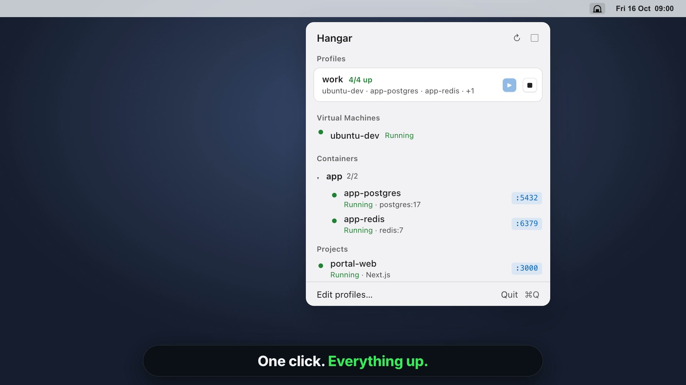

# Hangar

[](https://github.com/buracules/hangar/releases/download/v0.1.0/Hangar-0.1.0-intro.mp4)

A native macOS menu bar app and CLI for everything you develop against: UTM virtual
machines, Docker containers and local Node or Python dev servers, side by side, started and
stopped together.

## Install

Download `Hangar-0.1.0.dmg` from [Releases](https://github.com/buracules/hangar/releases),
open it and drag Hangar to Applications. It is signed and notarized. Requires macOS 15 or
later.

Hangar lives in the menu bar; its window opens from there (it shows in the Dock only while
the window is open). The first time it drives UTM, macOS asks whether Hangar may control
UTM: allow it.

## Highlights

**Menu bar**
- Profiles, VMs and containers at a glance, each with its status: shape, colour and word.
- Start or stop a whole profile, a VM, or a compose project in one click; open published
  ports in the browser.
- The icon fills in while anything runs and shows an alert when a profile member crashes or
  turns unhealthy.

**Virtual machines (UTM)**
- Start, suspend, shut down (asks the guest OS) or force stop, with a confirmation.
- Works while UTM is closed: VMs are listed from the last time UTM was seen, and starting one
  launches UTM hidden in the background.
- Backend, cores, memory, IP addresses (with the QEMU guest agent) and an activity timeline:
  what started or stopped each VM, and when.

**Containers (Docker)**
- Grouped by compose project; start, stop, restart. Talks to the Docker socket directly
  (Docker Desktop, OrbStack, Colima or `DOCKER_HOST`).
- Live logs with local timestamps, ANSI colours, ERROR/WARN highlighting, filter, wrap and
  follow.
- **Database tab** for Postgres containers: browse databases and tables, page through rows
  200 at a time with a WHERE filter, see columns, keys and indexes, and run SQL with syntax
  highlighting and history. Credentials come from the container's environment; nothing to
  set up.

**Projects (Node and Python dev servers)**
- Add a folder and Hangar works out how to run it: the `dev` script of a `package.json` with
  the package manager its lockfile names (Next.js and Vite recognised), Django, FastAPI,
  Flask or a plain Python app.
- Picks a free port when the usual one is taken, waits until it answers, health-checks it,
  and shows its output live. Stopping it, or quitting Hangar, stops everything it spawned.
- Each running project gets a stable address, `http://<name>.localhost` (or the `hostname`
  you set), served by Hangar's built-in proxy — no port to remember, no /etc/hosts edits.
  WebSockets and hot reload pass through. The proxy takes port 80 when it is free
  (otherwise 7878, 8787 or 9977) and only answers this Mac.
- Configure it with a `.hangar.json` in the project folder when detection is not enough:

  ```json
  {
    "name": "Canvas",
    "command": "node --watch server.js",
    "port": 4301,
    "hostname": "canvas.localhost",
    "healthCheck": "/api/health",
    "openPath": "/",
    "autoOpen": true,
    "restartOnCrash": false,
    "env": { "NODE_ENV": "development" }
  }
  ```

**Profiles**
- A named set of VMs and containers, e.g. a VM plus the databases it needs. Start all, stop
  all, add members by compose project, rename or delete — from the window, the menu bar or
  the CLI.

## CLI

The app binary is also the CLI: run it with a command and it does that and exits.

```sh
ln -s /Applications/Hangar.app/Contents/MacOS/Hangar ~/.local/bin/hangar

hangar status
hangar up work            # start a profile
hangar down work
hangar vm start ubuntu-dev
hangar ps
hangar logs -f app-postgres
hangar sql app-postgres "select * from users limit 5"
hangar project add ~/code/portal-web
hangar help
```

Profiles can be managed entirely from the CLI — handy for scripts, or for letting Claude
set them up:

```sh
hangar profile create work
hangar profile add work ubuntu-dev app-postgres     # VMs by name/UUID, containers by name/id
hangar profile add work container:db                 # prefix when a name means both
hangar profile remove work app-postgres
hangar profile rename work "work 2"
hangar profile show "work 2" --json
```

Every listing, project and profile command takes `--json` for machine-readable output.
Projects are started and stopped from the app, which owns their processes.

The app and the CLI share their state as JSON in `~/Library/Application Support/Hangar/`
(`profiles.json` and `projects.json` are meant to be hand-editable), so a change from either
side shows up in the other.

## Build

Requires Xcode, [XcodeGen](https://github.com/yonaskolb/XcodeGen), swift-format and SwiftLint.

```sh
make build     # generate the project and build
make test      # unit tests (Swift Testing)
make format    # swift-format
make lint      # swift-format lint + SwiftLint
make run       # build and (re)launch the app
make install   # release build into /Applications, CLI pointed at it
make release   # signed, notarized DMG in dist/ (see Scripts/release.sh)
```

Hangar is not sandboxed — it needs the Docker socket, Apple Events to UTM and to start your
dev servers — so it is distributed outside the Mac App Store.
